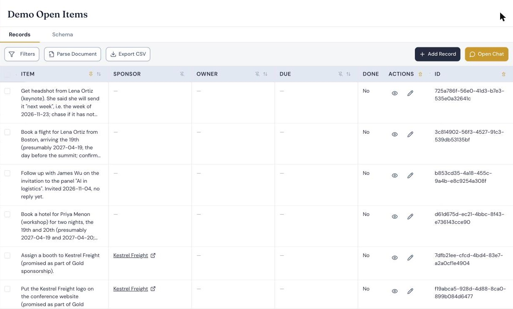
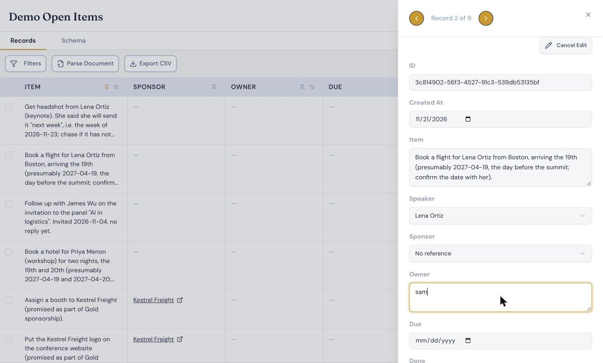
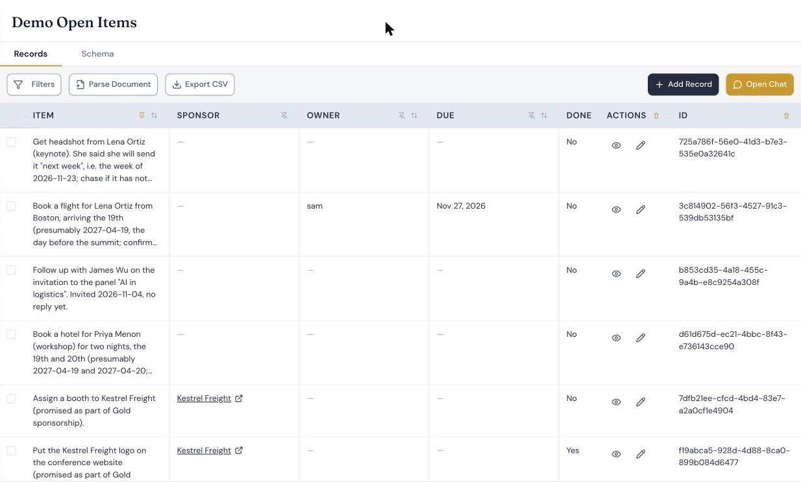
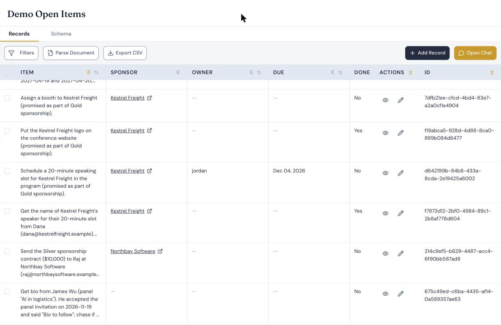

# Two assistants, one app, the same records

A short, real run showing why shared operational data matters. One AI assistant records a team's work, the records are corrected in the Alani Insights app, and a second assistant that has never seen any of it carries on from the corrected records.

**What this is.** A run on 2026-11-21 in an Alani Insights test workspace, with made-up data for a made-up conference. Every screenshot is the real app. The corrections were entered through the app's own edit form, the way a team member would make them. Each assistant was started by a person and given its task. Alani Insights held the records; it did not start, schedule, or coordinate the assistants.

## 1. An assistant writes down what the inbox says

Maya's assistant is given Monday's shared inbox: five emails about speakers and sponsors. It saves what it finds as records: 3 speakers, 2 sponsors, and 9 things still to do. It leaves the owner and due date empty, because no email said who would do what.

## 2. The records are tables a person can open

*The to-do list the assistant wrote, in the Alani Insights app. Nobody built this screen.*

## 3. The records are corrected in the app

Four changes, entered in the app's edit form:

| Record | Change |
| --- | --- |
| Book a flight for Lena Ortiz | Owner `sam`, due 2026-11-27, marked checked by a person |
| Schedule Kestrel Freight's speaking slot | Owner `jordan`, due 2026-12-04, marked checked by a person |
| Put the Kestrel Freight logo on the website | Marked done |
| Northbay Software (sponsor) | Amount corrected from 10,000 to 12,000, marked checked by a person |

## 4. A second assistant picks up where things stand

Jordan's assistant is a separate assistant. It was not told about the first assistant or about the four changes. It was given Thursday's inbox (three emails), access to the workspace, and one question:

> What is still outstanding? For each item tell me who owns it and when it is due.

It read the tables, updated them from the three emails, and answered. The first two lines of its answer:

| Item | Owner | Due |
| --- | --- | --- |
| Book Lena Ortiz's flight from Boston | Sam | 2026-11-27 |
| Schedule Kestrel Freight's 20-minute speaking slot | You (Jordan) | 2026-12-04 |

Those owners and dates exist in only one place: the edits made in the app in step 3.

## 5. What we checked afterward

We read every record back after the run.

- **It used the assignments entered in the app.** Sam's flight and Jordan's speaking slot came back with the owners and dates entered in the app.
- **It respected what was closed.** The website logo item, marked done in the app, was not listed as outstanding.
- **It left corrected records alone.** Both items marked "checked by a person" were untouched, and the sponsor amount was still 12,000. It said it would not change a checked record without asking.
- **It did not duplicate anything.** Still 2 sponsors. Speakers went from 3 to 4, because Thursday's email named a new one. Items went from 9 to 10, because one email created a new task.
- **It did its own work too.** It marked James Wu confirmed, recorded Lena's headshot, added the new speaker, and closed three items the emails had resolved.
- **It fetched what it needed.** 34 requests in all, using filters and selected columns to find records.

## Why it matters

An assistant remembers its own conversations. It does not know what another assistant did, or what a person decided since. Here, two assistants that never exchanged a message, with corrections entered in the app in between, all acted on the same facts, because the facts lived in one shared place that each of them could read and change.

## Reproduce it

This example is a recorded run, not a script: the point is two separate assistants and the app, so there is nothing to automate end to end. Everything needed to repeat it is in this folder.

| File | What it is |
| --- | --- |
| [`tables.json`](tables.json) | The three tables, with every field and its written description |
| [`inbox-monday.md`](inbox-monday.md) | The five emails given to the first assistant |
| [`inbox-thursday.md`](inbox-thursday.md) | The three emails given to the second assistant |
| [`frames/`](frames) | The screenshots used above |

Steps:

1. In a test workspace, create the three tables from `tables.json`, in the app or over REST.
2. Start an assistant, give it access to the workspace and `inbox-monday.md`, and ask it to record what the emails say.
3. In the Alani Insights app, make the four changes listed in step 3 above.
4. Start a different assistant in a fresh conversation. Give it access to the workspace and `inbox-thursday.md`. Do not mention the first assistant or the changes. Ask: "What is still outstanding? For each item tell me who owns it and when it is due."
5. Read the records back and compare them with the checks in step 5 above.

The field descriptions do real work here. The `checked_by_person` description tells an assistant not to overwrite a checked row without asking, and the `owner` description tells it to leave the owner empty when nobody has taken the item. The second assistant followed both because it read the schema first.

Any assistant that can call a REST API or connect to the [Alani Insights MCP server](https://www.bundleiq.com/alani-insights/mcp-server) can take either role.
